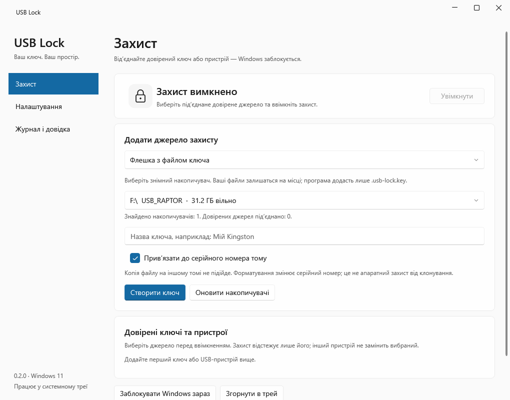
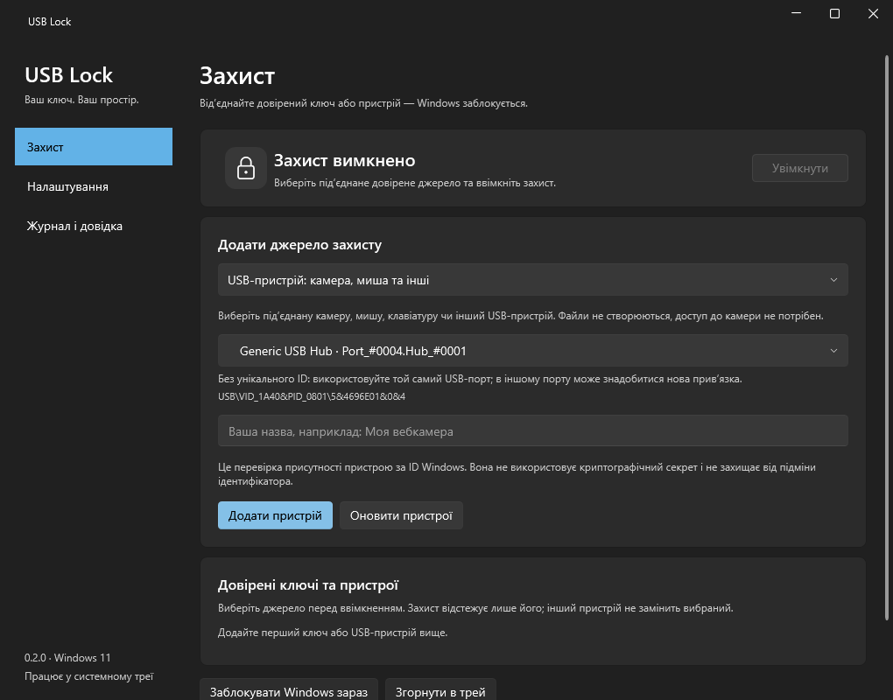



  

<h1 align="center">USB Lock</h1>

  <strong>Your key. Your space.</strong> 
  Unplug a trusted USB stick or device and Windows locks itself after a short countdown.

  <strong>Built with</strong> 
  
  
  
  
  
  

  <a href="#run-it">Run it</a> &middot;
  <a href="#security-boundaries">Security boundaries</a> &middot;
  <a href="./REPORT.md">Feature report</a> &middot;
  <a href="./README.uk.md">Українською</a>

## What is USB Lock?

USB Lock is a small Windows tray app that turns a USB stick, webcam, mouse receiver, or other USB device into a physical "presence key". While protection is on, removing that key starts a countdown and then triggers the standard Windows lock screen. Plug the **same** key back in before the countdown ends and the lock is cancelled.

It never replaces Windows sign-in: you unlock with Windows Hello or your password as usual. There is no automatic USB login, no master key, and no custom lock screen.

The interface is in Ukrainian and uses WPF-UI with Mica, rounded cards, the system accent color, and light/dark/system themes.

  
  

## What you can do

| Area                       | Highlights                                                                                                              |
| -------------------------- | ----------------------------------------------------------------------------------------------------------------------- |
| **USB key files**          | Write a random 256-bit key to any removable drive, optionally bound to the volume serial number. Existing files stay put. |
| **USB peripherals**        | Trust a webcam, mouse, keyboard, hub, or other USB device by its exact Windows PnP instance ID. Nothing is written to it. |
| **Removal countdown**      | Choose a delay from 0 to 3600 seconds. Re-inserting the same key cancels the pending lock.                              |
| **Multiple trusted keys**  | Name, select, and revoke keys and devices. Protection follows only the source you picked; another key can't stand in for it. |
| **Tray workflow**          | Close to tray, arm/disarm from the menu, lock Windows on demand, and optionally cancel a countdown.                      |
| **Startup options**        | Start at sign-in, start minimized, and auto-arm once a trusted source is connected. All off by default.                 |
| **Notifications & sound**  | Optional Windows notifications and a system sound before the lock.                                                      |
| **History**                | A local activity log with rotation; the app shows the latest 100 entries.                                               |
| **Import / export**        | Move non-secret preferences between machines. Import shows a preview before anything is applied.                        |

## Run it

### Use the ready-made build

1. Open `dist/USB-Lock-0.2.0/UsbLock.exe`, or double-click `Start USB Lock.cmd`.
2. That's it. The win-x64 package is self-contained, so you don't need to install .NET, and you don't need admin rights.

> Keep the **whole** `USB-Lock-0.2.0` folder together. Copying only the `.exe` won't work.

If an older build is already running, the new one won't start next to it. Quit the old one from the tray menu first. Protection pauses while you switch, and your settings and trusted keys carry over.

### Protect with a USB stick

1. Plug in a removable USB drive and pick it on the **Захист** (Protection) page.
2. Give the key a name, keep or turn off the volume-serial binding, and click **Створити ключ** (Create key).
3. Select the key in the trusted list and click **Увімкнути** (Turn on). The app starts disarmed.
4. Pull the stick out to start the countdown. Put the same stick back to cancel it.

The app never formats or renames the drive and won't overwrite an existing `.usb-lock.key`. If a stick already has one, choose another drive or delete the old file yourself if you no longer need it. USB Raptor `.k3y` keys aren't compatible and are left alone.

### Protect with a USB device

1. In **Додати джерело захисту** (Add a protection source), choose **USB-пристрій: камера, миша та інші** (USB device: camera, mouse, and others).
2. Pick the device, give it a short name if you like, and click **Додати пристрій** (Add device).
3. Select it in the trusted list and turn protection on. Unplugging it starts the countdown.

A camera with a built-in microphone appears as one physical device. USB controllers and root hubs are hidden, but external hubs can be chosen. The app never opens video or audio streams, and closing a camera app doesn't count as unplugging it.

To switch sources, turn protection off, select another trusted key or device, and turn it back on.

## Daily use

- **Closing the window** sends the app to the tray. Left-click the tray icon to reopen it; right-click for protection, manual lock, and exit.
- **Exiting** the app stops protection.
- **Settings** (Налаштування) are applied with **Зберегти** (Save). They cover the delay, notifications, sound, start at sign-in, start in tray, auto-arm, and theme.
- **Auto-arm** at startup picks the first connected trusted source in list order. Turning protection on by hand always uses the source you selected and won't swap in another one.
- **Export** never includes trusted keys, device bindings, passwords, or the startup registration.

Before turning on start at sign-in, put the app folder somewhere permanent. If you move it later, open it from the new location and save the startup option again. Before deleting the app, turn off start at sign-in and quit from the tray.

## Security boundaries

USB Lock is a convenience lock for your own session. Here is what it does and doesn't protect against.

- **It's a user app.** It runs in your session. It isn't a system service and doesn't defend against an administrator or someone who can end it from Task Manager.
- **Key files** hold a random 256-bit secret. The PC stores only its SHA-256 fingerprint, and settings are encrypted with current-user DPAPI. If DPAPI fails, nothing falls back to plain text.
- **Volume binding** uses the volume serial number, not the USB hardware serial. Reformatting changes it, and a deliberate clone can't be ruled out.
- **Device binding** checks that a Windows instance ID is present; it doesn't verify a secret. Devices without a unique serial may be tied to a USB port, so two identical devices in the same port can share an ID. The app shows a note when this applies.
- **Wireless mice** are tracked through their USB receiver, not the mouse itself.
- **Only "Removable" drives** are listed. USB SSDs that Windows reports as Fixed aren't supported yet.
- **Detection timing** is about 750 ms plus device access time. A delay of 0 means "lock as soon as removal is noticed", and a hung driver can slow that down.
- **Revoking** a key removes local trust but leaves the file on the USB stick. Keys only work on the PC and Windows account that created them.
- **Losing the key** never locks you out: normal Windows sign-in always works.

### Where data lives

| File                                     | Contents                                                       |
| ---------------------------------------- | -------------------------------------------------------------- |
| `%LOCALAPPDATA%\USB Lock\settings.dat`   | Preferences and trusted keys/devices, encrypted with DPAPI.    |
| `%LOCALAPPDATA%\USB Lock\activity.log`   | Activity history; rotates at about 512 KB.                     |

To reset everything, quit the app and rename that folder. You'll need to create new keys afterwards.

## Development

You need Windows and the .NET 8 SDK.

| Command                                            | What it does                                                                                          |
| -------------------------------------------------- | ----------------------------------------------------------------------------------------------------- |
| `dotnet build UsbLock/UsbLock.csproj -c Release`   | Builds the app.                                                                                       |
| `dotnet run --project UsbLock.Checks -c Release`   | Runs the core checks: guard state, countdown, key validation, and device identity. Never locks Windows. |
| `dotnet run --project UsbLock.UiCheck -c Release`  | Opens a test WPF window, lists USB devices read-only, renders each page to `artifacts/`, and exits.   |
| `./publish.ps1`                                    | Publishes a self-contained win-x64 build to `dist/USB-Lock-0.2.0`.                                    |

`UsbLock.UiCheck` checks layout, not real clicks or a real Windows lock. It also tests DPAPI in a separate folder when the user profile allows it.

## Project map

    UsbLock/
      Core.cs            Trusted keys, preferences, key validation, guard state machine, device identity
      Services.cs        DPAPI storage, removable-drive scanning, key files, native Windows calls
      UsbPeripherals.cs  SetupAPI enumeration of physical USB devices and protection sources
      MainWindow.xaml    WPF-UI window: Protection, Settings, and History & help pages
      App.xaml           Startup, single instance, tray, and theme
      Assets/            App icon (SVG and ICO)
    UsbLock.Checks/      Console checks for the core logic (no UI, no locking)
    UsbLock.UiCheck/     Render-only WPF checks that write screenshots to artifacts/
    artifacts/           Rendered page screenshots in light, dark, and compact sizes
    publish.ps1          Self-contained release publish
    Start USB Lock.cmd   Shortcut that opens the current release build

## More docs

- [REPORT.md](REPORT.md): feature matrix, verification results, and manual test steps (in Ukrainian).
- [PLAN.md](PLAN.md): the original implementation plan and what was deliberately left out.
- [README.uk.md](README.uk.md): this README in Ukrainian.
- [LockWorkStation](https://learn.microsoft.com/en-us/windows/win32/api/winuser/nf-winuser-lockworkstation) and [SetupDiGetClassDevs](https://learn.microsoft.com/en-us/windows/win32/api/setupapi/nf-setupapi-setupdigetclassdevsw): the Windows APIs USB Lock relies on.

  Made by <a href="https://github.com/SanekxArcs">SanekxArcs</a>. 
  README badges powered by <a href="https://shieldcn.dev">shieldcn.dev</a>.

